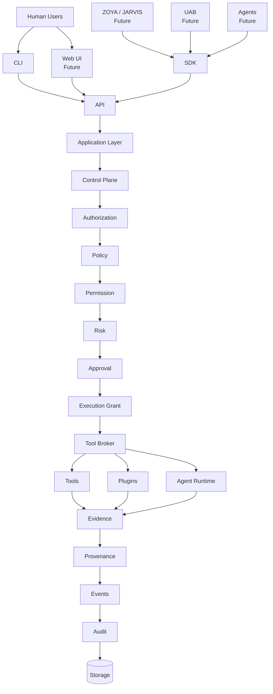
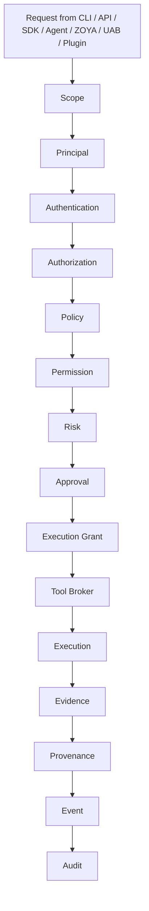
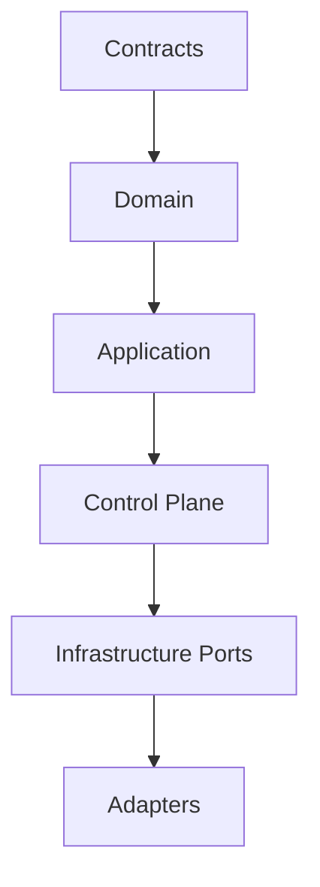

# CYBEROS Architecture

**Phase 0 Foundation Document**

## 1. High-Level System Architecture

## 2. Security Execution Chain (Non-Bypassable)

**Invalid paths (forbidden):**

- CLI → Shell
- CLI → Tool
- API → Tool
- Agent → Tool
- ZOYA → Tool
- UAB → Tool
- Plugin → Tool
- Web UI → Tool

## 3. Module Dependency Direction

Outer interfaces (CLI, API, SDK, Plugins, Agents, ZOYA, UAB) communicate through stable contracts only.

**Domain must never depend on:**

- PostgreSQL / SQL drivers
- HTTP frameworks
- CLI frameworks
- AI providers
- External security tools

## 4. Future Layers (Not Implemented in Phase 0/1)

- Plugin system (out-of-process, language-neutral)
- Agent runtime (constrained principals)
- ZOYA / JARVIS (orchestration, depends on CYBEROS)
- UniversalAIBridge (UAB)
- Provider-neutral AI adapters
- Distributed workers
- Multi-tenancy / cloud

## 5. Current Status

Phase 0 establishes only the skeleton, package boundaries, documentation, and build foundation. No business logic is present.
