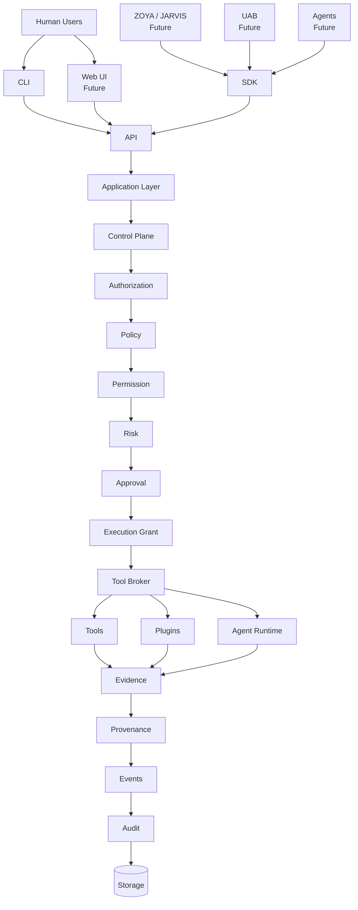
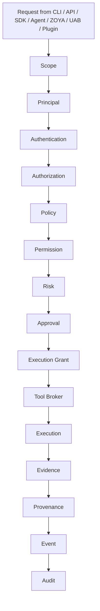
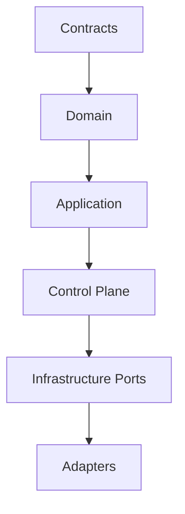
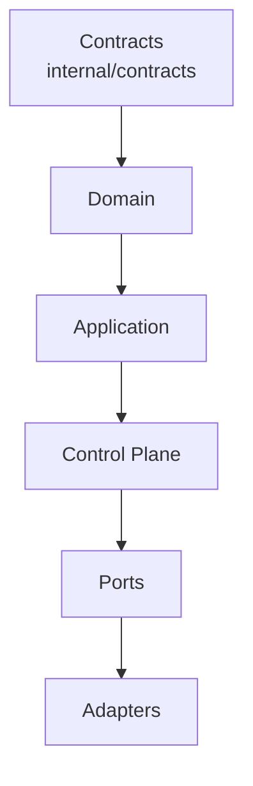
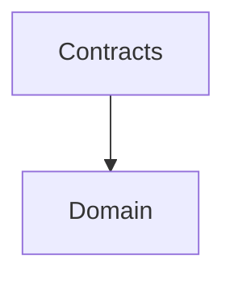

# CYBEROS Architecture

**Phase 0 Foundation Document**

## 1. High-Level System Architecture



## 2. Security Execution Chain (Non-Bypassable)



**Invalid paths (forbidden):**

- CLI → Shell
- CLI → Tool
- API → Tool
- Agent → Tool
- ZOYA → Tool
- UAB → Tool
- Plugin → Tool
- Web UI → Tool

## 3. Module Dependency Direction



Outer interfaces (CLI, API, SDK, Plugins, Agents, ZOYA, UAB) communicate through stable contracts only.

**Domain must never depend on:**

- PostgreSQL / SQL drivers
- HTTP frameworks
- CLI frameworks
- AI providers
- External security tools

## 4. Future Layers (Not Implemented in Phase 0/1)

- Plugin system (out-of-process, language-neutral)
- Agent runtime (constrained principals)
- ZOYA / JARVIS (orchestration, depends on CYBEROS)
- UniversalAIBridge (UAB)
- Provider-neutral AI adapters
- Distributed workers
- Multi-tenancy / cloud

## 5. Current Status

Phase 0 establishes only the skeleton, package boundaries, documentation, and build foundation. No business logic is present.

## 6. Phase 1A — Contracts Layer (Implemented)

As of Phase 1A the stable contract package `internal/contracts` exists and sits at the top of the dependency hierarchy.



**Properties of the contracts package:**

- Infrastructure-neutral (only stdlib: `errors`, `fmt`, `time`)
- Defines typed IDs, Principal, Scope, Task, Capability, Policy, Permission, Risk, Approval
- Defines structured `Decision` (never a bare boolean)
- Defines `ExecutionGrant` with usability semantics
- Defines `ToolBroker` / `Executor` interface boundaries
- Defines versioned `EventEnvelope`
- Defines Evidence, Finding, Provenance shapes
- Defines stable error sentinels

No implementations of Control Plane, Task Engine, Broker, persistence, API, or tools exist yet.

## 7. Phase 1B — Domain Layer (Implemented)

Pure domain entities live under `internal/domain/*` and depend only on `internal/contracts` + stdlib.



Implemented domain packages: project, asset, scope, task, principal, capability, grant, evidence, finding, provenance, plus thin policy/permission/risk/approval helpers.

Task carries an explicit, tested state machine. ExecutionGrant domain helpers enforce usability and context matching.

## 8. Phase 1C — Persistence (Implemented)

Repository ports live in `internal/storage/ports`.  
PostgreSQL adapter lives in `internal/storage/postgres`.  
Domain remains free of SQL.

## Phase 1 Status

Phase 1 Secure Core is complete (`v0.1.0-phase1`).

Modular monolith with:
- Contracts → Domain → Application/Identity/Scope → Control Plane → Grant Issuer → Tool Broker (mock) → Evidence/Findings/Provenance → Events/Audit
- Thin API v1 + CLI + SDK
- PostgreSQL persistence ports/adapter for core entities

## Phase 2D — Execution Lifecycle

`internal/execution/lifecycle.Controller` runs grant-gated work through the Tool Broker,
records `ExecutionRecord` (task/grant/principal/scope/attempt/metrics), and enriches
Evidence / Findings / Provenance / Audit.

Flow: Grant → Broker → Sandbox → Executor → Evidence (+ optional Finding) → Provenance

## Phase 2 Status — COMPLETE

Validated end-to-end:

Task → Schedule → Dependencies → Retry/Timeout → Resource Policy/Sandbox →
Control Plane → Grant → Broker → Execution Lifecycle → Evidence → Finding →
Provenance → Audit

Tag: `v0.2.0-phase2`

## Phase 3E — Plugin + Tool Adapter Architecture

- `contracts.PluginManifest` / `PluginRuntime` / `PluginState`
- `plugin.Adapter`: Manifest, Validate, Prepare (no Execute)
- `plugin.Registry`: Register → Activate → Disable; optional capability discovery
- All real execution remains Tool Broker → Sandbox under grant
- Discovery ≠ authorization

## Phase 3F — Extensible Tool Execution Runtime

- `contracts.ToolManifest` / `ToolExecutor`
- `execution.Registry` + `Router` (dispatch by grant executor hints)
- `execution/process` fail-closed external process boundary (allowlist required)
- `execution/runtime` Go/Python/Rust labeled adapters (no hard-coded tools)
- Chain: Grant → Broker → Sandbox → Router/Executor

## Phase 3G — Security Tool Adapter Layer

- `tools.Adapter` / `Descriptor` / `NormalizedResult` / health checks
- `tools.Manager` registers adapters and exposes `ToolExecutor`s
- Stub scanner demonstrates pluggable assessment adapters (not a real scanner)
- Future Nmap/Nuclei/FFUF adapters follow the same interface without core changes
- Fail-closed on unknown tools; capability must match descriptor

## Phase 3H — Process Runtime + Execution Hardening

- Explicit executable allowlist; shell disabled by default
- ValidateArgv (no compound shell strings); SanitizeEnv (no secret keys)
- process.Result: exit code, duration, timeout, truncated output
- tools.ProcessToolAdapter: binary from descriptor, version health probe
- No security product hard-coded in core

## Phase 3I — Assessment Orchestration Foundation

- `Assessment` model bound to project/scope/principal/target
- State machine: CREATED → PLANNED → RUNNING → SUCCEEDED|FAILED|CANCELLED
- Sequential steps by capability (+ optional executor hint)
- Each step issues its own grant via GrantIssuer then Broker.Execute
- Evidence/findings/provenance/events hooks
- Orchestration ≠ authorization

## Architecture audit

See **[ARCHITECTURE_AUDIT.md](./ARCHITECTURE_AUDIT.md)** (2026-08-20, based on tag `v0.3.0-phase3i`).

That document is the roadmap audit (sections A–J): completed vs partial layers, risks, recommended Phase 3J+, and what must not change.

## Phase 3 Status — COMPLETE (`v0.3.0-phase3j`)

Assessment + Tools wired through SDK/API/CLI with Control Plane grants.
Extension boundaries: `docs/EXTENSIONS.md`.

## Phase 4C — Atomic leases

- `TryClaimAtomically` + `ClearExpiredLeases` on runner Store
- PostgreSQL: `FOR UPDATE SKIP LOCKED` on PENDING tasks
- Claim never sets AUTHORIZED/RUNNING or issues grants

## Phase 5 — Auth + Tenant Isolation

See `docs/AUTH.md`. Auth middleware optional on API; principals bind from API keys.

## Phase 6D — Findings pipeline

```
NormalizedResult → Finding Mapper (Ingest) → Evidence refs → Correlation queries → Events/Audit
```

Findings are **observations**, not authorization. See fingerprint dedup statuses: NEW/UNCHANGED/UPDATED/REOPENED/RESOLVED.

## Phase 6E — Asset & Target Intelligence

```
Target → Asset → ServiceEndpoint → Observation → (Findings via existing pipeline)
```

Inventory is observation-only; never authorizes execution.

## Phase 6F — Risk prioritization

See `docs/RISK.md`. Downstream of findings/assets; never linked to Broker/Executor.

## Phase 6G — Cases & Reports

See `docs/CASES.md`. Downstream of findings/risk; never linked to Broker/Executor.

## Phase 6H — Freeze

See `docs/PHASE6_FREEZE.md`. Assessment post-exec pipeline wires assets/findings/risk/cases without touching Broker.


## Phase 7 (frozen at v0.7.0)

Durable platform: PostgreSQL ports for findings/risk/cases/reports/API keys; `sdk.NewProduction`; mandatory auth in production serve. See `docs/PHASE7.md`.


## Phase 8 (frozen at v0.8.0)

Operational hardening: durable evidence/provenance/inventory endpoints; API tenant/project isolation; bootstrap hygiene. See `docs/PHASE8.md`.


## Phase 9 (frozen at v0.9.0)

Tool runtime & pack ecosystem: process policy, pack lifecycle, constrained nmap/HTTP probe, durable execution records. See `docs/PHASE9.md`.


## Phase 10 (frozen at v0.10.0)

Capability-driven workflow orchestration on existing Task Engine + Lifecycle. See `docs/PHASE10.md`.


## Phase 11 (frozen at v0.11.0)

Extensible pack/manifest/schema/loader model. Install = discovery only. See `docs/PHASE11.md`.
