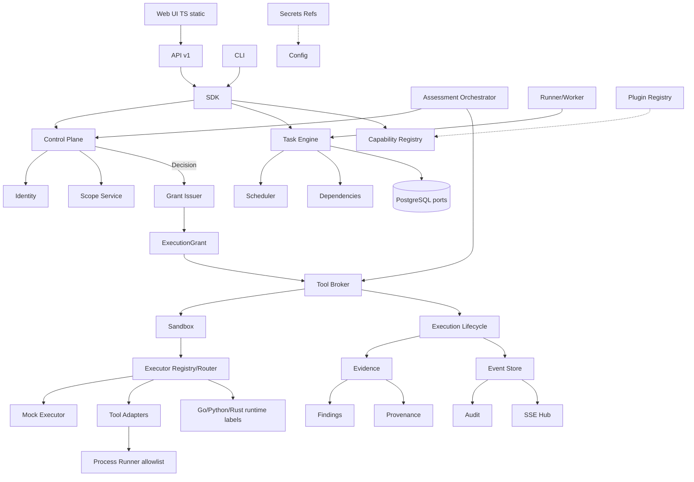

# CYBEROS Architecture Audit Report

**Basis:** historical audit at `v0.3.0-phase3i`; **current freeze is `v0.6.0` (Phase 6H)** — see docs/PHASE6_FREEZE.md  
**Date of audit:** 2026-08-20  
**Status:** Project document — guidance for Phase 3J+ planning. Not an implementation approval.

---

## A. Current Architecture

CYBEROS is a **Go modular monolith** with hexagonal/clean boundaries:

| Layer | Location | Role |
|--------|----------|------|
| Contracts | `internal/contracts` | IDs, grants, decisions, events, tools, assessments |
| Domain | `internal/domain/*` | Pure entities (task, scope, principal, grant, …) |
| Application | `internal/application/scope` (+ empty stubs for task/project/…) | Thin services |
| Control plane | `internal/controlplane` | Scope→Principal→AuthZ→Policy→Permission→Risk→Approval → **Decision** |
| Task system | `taskengine`, `scheduler`, `dependency`, `runner` | Lifecycle, schedule, deps, claim/lease |
| Execution | `broker`, `execution/{mock,sandbox,process,runtime,lifecycle,registry}` | Sole gateway + backends |
| Tools | `tools`, `plugin` | Adapter/manager; process-backed tools |
| Assessment | `assessment` | Sequential orchestration over capabilities |
| Evidence stack | `evidence`, `findings`, `provenance`, `events`, `audit` | Post-execution lineage |
| Persistence | `storage/ports` + `storage/postgres` | PG adapters; migrations `001`, `002` |
| Surfaces | `api/v1`, `cli`, `sdk`, `web/ui` | HTTP/CLI/SDK/static UI |
| Cross-cutting | `config`, `secrets`, `resource`, `identity`, `logging` | Config, refs, limits |

**Security spine (implemented and tested):**

Scope → Principal → Control Plane → Grant → Tool Broker → Sandbox → Executor → Evidence → Finding → Provenance → Event → Audit

Scheduling, runners, plugins, discovery, and assessment orchestration are designed **not** to authorize by themselves; grants remain mandatory per execution.

Language posture in-repo: **Go core only**. Python/Rust are runtime *labels* and docs, not separate services. TypeScript is a thin static UI under `web/ui` / embedded `api/v1/static`. Empty dirs under `internal/adapters/{ai,tools,external,filesystem}` and most `application/*` are placeholders from foundation scaffolding.

---

## B. Completed Layers

| Checkpoint | Tag | Status |
|------------|-----|--------|
| Phase 0 foundation | `v0.0.0-foundation` | Structure, docs, module |
| Phase 1 Secure Core | `v0.1.0-phase1` (+ 1a–1k) | Contracts, domain, PG ports, identity/scope, control plane, capabilities/tasks, grants, mock broker, evidence/provenance, events/audit, API/CLI/SDK, E2E security tests |
| Phase 2 Task + Execution | `v0.2.0-phase2` (+ 2a–2e) | SCHEDULED/deps/retry/timeout, resource policy + sandbox, execution lifecycle, Phase 2 E2E |
| Phase 3A | `v0.3.0-phase3a` | Catalog API/CLI, static dashboard UI, SSE path later |
| Phase 3B | `v0.3.0-phase3b` | Durable task columns, `ListByState`/`ListDueScheduled`, runner promote/claim |
| Phase 3C | `v0.3.0-phase3c` | Worker loop, lease recovery, runner events, `events.Hub` + SSE |
| Phase 3D | `v0.3.0-phase3d` | `secrets.Ref`/resolvers/redaction, config secret refs |
| Phase 3E | `v0.3.0-phase3e` | Plugin manifest/registry, Prepare-only adapters |
| Phase 3F | `v0.3.0-phase3f` | ToolManifest/ToolExecutor, executor registry/router, process boundary (fail-closed) |
| Phase 3G | `v0.3.0-phase3g` | `tools.Manager`/Adapter, stub scanner, normalized results |
| Phase 3H | `v0.3.0-phase3h` | Process hardening (allowlist, no shell, argv/env), `ProcessToolAdapter` |
| Phase 3I | `v0.3.0-phase3i` | Assessment model/state machine, sequential orchestrator, per-step grants |

**Test posture:** Broad `tests/security` and `tests/integration` (Phase 1 chain + Phase 2 path). Security regressions are a real strength of the repo.

---

## C. Partial / Missing Layers

### Partially implemented

- **PostgreSQL:** Repos + migrations exist; default `sdk.NewInMemory()` / demo **Catalog** still drive API/UI, not live PG listings.
- **Runner/worker:** In-process leases + metadata; DB columns for lease exist but multi-node lease consensus is not real.
- **Events/audit:** In-memory append-only store; not durable/outbox/Kafka.
- **SSE:** Hub + `/api/v1/events/stream`; not authn-scoped multi-tenant streams.
- **Secrets:** Env/map resolvers + redaction; no Vault/KMS/file resolver production path.
- **Plugins:** Registry + Prepare; no disk loading, signing, or out-of-process host.
- **Tools:** Stub + process adapter pattern; **no** real Nmap/Nuclei/FFUF adapters in tree.
- **Assessment:** Foundation orchestrator + in-memory store; not API/CLI fully exposed; sequential only.
- **Application layer:** Only `application/scope` is real; `task`/`project`/`execution` dirs empty.
- **Web UI:** Static foundation (counts/tables); no create/run assessment flows.
- **SDK:** In-process client; not a versioned external automation SDK.
- **Adapters dirs (`ai`, `tools`, …):** Empty placeholders overlapping `internal/tools` / `plugin`.

### Missing (relative to OS vision)

- Authn (OIDC/API keys/mTLS), multi-tenant isolation enforcement at API edge
- Durable/distributed queues and workers
- Persistent event/audit store and forensic query
- Real tool pack + version pinning + supply-chain checks
- Findings correlation, risk scoring, reporting
- Asset/target discovery pipelines
- Owner/domain verification, private disclosure
- Notifications, observability (metrics/traces), backup/DR
- AI / ZOYA / JARVIS / UAB (docs only)
- Admin / Break-Glass (explicitly final-stage)

---

## D. Architectural Risks / Technical Debt

1. **Dual “catalog” vs durable task truth** — UI/API can show demo Catalog while tasks live in engine/PG; drift risk.
2. **Overlapping extension surfaces** — `plugin`, `tools`, `execution/runtime`, empty `adapters/*` need a single public extension story.
3. **In-memory security-critical stores** — events, audit, evidence, grants nonces, runner leases: fine for foundation, weak for production forensics.
4. **Broker/router wiring defaults** — production default path is still sandbox→mock in SDK; tool registry is opt-in.
5. **Process enablement** — fail-closed is correct; enabling allowlists without supply-chain controls is a future foot-gun.
6. **Assessment GrantIssuer** — interface is right; production issuer must always call real Control Plane (tests use static issuer).
7. **Empty application packages** — invite parallel logic in engine/API instead of one application layer.
8. **Scale** — single-process worker/SSE will not survive multi-node without lease/queue redesign (should be additive).

**Expansion without rewrite:** Still viable if the security spine and Broker-as-gateway stay frozen; gaps are mostly **wiring, persistence, and product surfaces**, not a wrong core.

---

## E. Recommended Next Phases

1. **Close Phase 3** with integration of assessment + tools + durable listings (no new product domains).
2. **Phase 4** — Persistence & platform durability (PG-backed catalog/events/audit, real worker leases).
3. **Phase 5** — Authn + multi-tenant API hardening.
4. **Phase 6** — First real tool packs (still adapters, not core).
5. **Phase 7+** — Correlation, reporting, distributed execution, AI/UAB, Admin last.

---

## F. Exact Phase-by-Phase Roadmap

| Phase | Focus |
|-------|--------|
| **3J** | Phase 3 integration: wire Assessment + Tools into API/CLI/SDK; Catalog from durable tasks; E2E assessment path under real CP grants; docs/tag Phase 3 complete |
| **3K** (optional) | Thin API for assessment status/events only; no new domains |
| **4A** | PG-backed projects/scopes/tasks listings replacing SeedDemo |
| **4B** | Durable events/audit store + migration |
| **4C** | DB-backed runner leases / claim atomicity |
| **5A** | Authentication (API keys/OIDC) on API/SSE |
| **5B** | Tenant/project isolation middleware |
| **6A–B** | First external tool adapters (allowlisted binaries) + health/version |
| **7** | Findings correlation + risk scoring |
| **8** | Reporting + notifications |
| **9** | Distributed workers/queues |
| **10** | Vault/KMS secrets |
| **11** | Plugin load/sign/sandbox host |
| **12** | AI analysis adapters (via SDK only) |
| **13** | Owner verification / private disclosure |
| **Final** | Admin / Break-Glass |

---

## G. Dependency Diagram (Mermaid)

---

## H. What MUST NOT Be Changed

- Non-bypassable chain: **Scope → Principal → CP → Grant → Broker → Sandbox → Executor → Evidence → … → Audit**
- Broker as **sole** execution gateway
- Discovery/schedule/orchestrate/UI/plugin/worker **≠** authorization
- No valid grant ⇒ no execution
- Process **fail-closed**; no unrestricted shell
- No hard-coded commercial/scanner products inside core packages
- ZOYA/JARVIS/UAB/AI **depend on** CYBEROS SDK/API, never the reverse
- Admin/Break-Glass **last**, not mid-roadmap
- Go remains core/runtime language of record

---

## I. What Should Be Postponed Until Later

| Item | When |
|------|------|
| Real Nmap/Nuclei/FFUF packs | After Phase 3 close + durable allowlist ops (Phase 6) |
| Distributed workers / global queues | Phase 9 |
| Vault/KMS | Phase 10 |
| Full plugin marketplace + signing | Phase 11 |
| AI / ZOYA / JARVIS / UAB runtime | Phase 12+ (docs already correct) |
| Owner verification / private disclosure | Phase 13 |
| Admin / Break-Glass | Final stage only |
| Major Web UI productization | After API auth + durable data (Phase 5+) |
| Public vulnerability disclosure workflows | Late product, not core infra |

---

## J. Final Recommendation: Phase 3J and After

### What Phase 3J should be

**“Phase 3 Integration & Closure”** — not a new subsystem.

Concrete goals:

1. Wire **Assessment Orchestrator** to real **Control Plane grant issuance** (not only test static issuers).
2. Expose assessment create/plan/run/status via **API + CLI + SDK** (thin handlers).
3. Point **Catalog/dashboard** at durable task/assessment state (PG or engine store), reduce SeedDemo reliance.
4. Optional: default SDK path can register **stub/process tool executors** behind Broker→Sandbox→Router without enabling shell.
5. One **Phase 3 E2E** test: assessment step → CP → grant → broker → tool/stub → evidence/audit.
6. Tag **`v0.3.0`** (Phase 3 complete) or `v0.3.0-phase3j` then freeze Phase 3 scope.

### What should come after

- **Phase 4:** Durability (listings, events/audit, leases)
- **Phase 5:** Authn + tenant isolation
- **Phase 6:** First real tool adapters
- Then correlation, reporting, distribution, secrets platform, plugins, AI, owner-verification
- **Admin/Break-Glass only at the end**

### Verdict

The architecture **still supports long-term expansion without restructuring**, provided Phase 3J **integrates** what exists rather than inventing parallel execution or authorization paths. The main debt is **product wiring and durability**, not a broken security model.

---

## Document control

| Field | Value |
|-------|--------|
| Source | Architecture roadmap audit (read-only inspection at `v0.3.0-phase3i`) |
| Location | `docs/ARCHITECTURE_AUDIT.md` |
| Related | `docs/ARCHITECTURE.md`, `docs/BUILD_PLAN.md`, `docs/SECURITY_MODEL.md`, `state/IMPLEMENTATION_STATE.md` |
