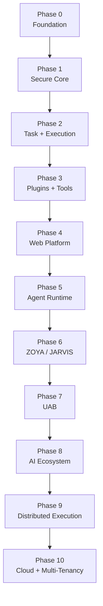
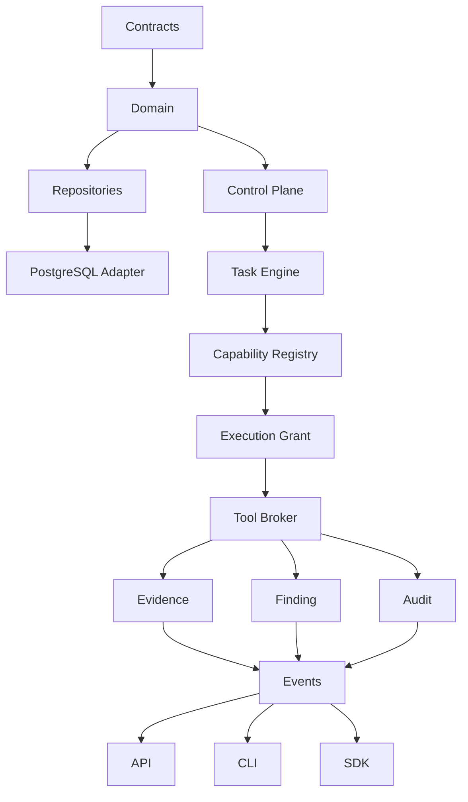

# CYBEROS Build Plan

**Phase 0 Foundation Document**

## High-Level Sequence

```
FOUNDATION
    ↓
CONTRACTS
    ↓
DOMAIN
    ↓
PERSISTENCE
    ↓
CONTROL PLANE
    ↓
TASK ENGINE
    ↓
CAPABILITY REGISTRY
    ↓
EXECUTION GRANTS
    ↓
TOOL BROKER
    ↓
EVIDENCE / FINDINGS
    ↓
PROVENANCE
    ↓
EVENTS / AUDIT
    ↓
API
    ↓
CLI
    ↓
SDK
    ↓
PLUGIN SYSTEM
    ↓
AGENT RUNTIME
    ↓
WEB UI
    ↓
ZOYA / JARVIS
    ↓
UAB
    ↓
ADVANCED AI
    ↓
DISTRIBUTED EXECUTION
    ↓
MULTI-TENANCY / CLOUD
    ↓
FULL CYBERSECURITY PLATFORM
```

## Phase Roadmap Diagram



## Dependency Graph (Core)



## Rules

- Do not implement modules out of order.
- Do not introduce real offensive tools or unrestricted execution before the control plane and Tool Broker are solid.
- Stop and validate at the end of each major phase.
