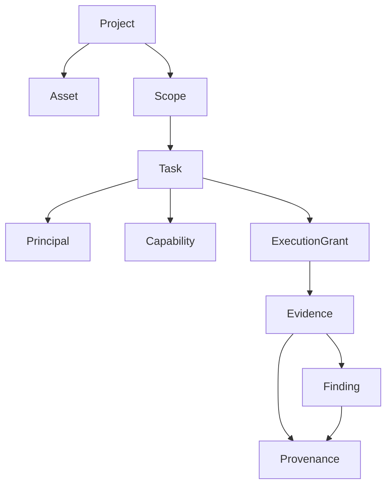

# CYBEROS Domain Model

**Phase 1B — Domain (Implemented)**

## Core Entities

| Entity | Package | Role |
|--------|---------|------|
| Project | `internal/domain/project` | Top-level container |
| Asset | `internal/domain/asset` | Target/resource within a project |
| Scope | `internal/domain/scope` | Root authorization boundary |
| Task | `internal/domain/task` | Unit of work with explicit state machine |
| Principal | `internal/domain/principal` | Actor (HUMAN minimum; extensible) |
| Capability | `internal/domain/capability` | Technically available action (≠ permission) |
| ExecutionGrant | `internal/domain/grant` | Bounded authorization for execution |
| Evidence | `internal/domain/evidence` | Output of an execution |
| Finding | `internal/domain/finding` | Interpreted security observation |
| Provenance | `internal/domain/provenance` | Full lineage (who/what/when/where/why) |

Policy / Permission / Risk / Approval result helpers live under corresponding domain packages; full evaluation belongs to the Control Plane.

## Hierarchy



## Task State Machine

Explicit transitions only. Illegal transitions return `ErrInvalidStateTransition`.

```
CREATED → PENDING | CANCELLED | EXPIRED
PENDING → AUTHORIZED | WAITING_APPROVAL | CANCELLED | EXPIRED
AUTHORIZED → READY | WAITING_APPROVAL | CANCELLED | EXPIRED
WAITING_APPROVAL → AUTHORIZED | CANCELLED | EXPIRED
READY → RUNNING | CANCELLED | EXPIRED
RUNNING → SUCCEEDED | FAILED | CANCELLED
SUCCEEDED / FAILED / CANCELLED / EXPIRED → (terminal)
```

## Key Invariants

- Scope is the authorization boundary; inactive/expired scopes are not active.
- Task must belong to a project + scope and reference a principal + capability.
- Capability existence does **not** imply authorization.
- ExecutionGrant is time-bounded and context-bound; `EnsureUsable` rejects expired or mismatched grants.
- Evidence is always linked to task + grant + principal + scope.
- Provenance answers who/what/when/under which scope/task/capability/grant.

## Purity

Domain packages import only `internal/contracts` and the Go standard library.

## Phase 1F — Capability Registry + Task Engine (Implemented)

### Capability Registry (`internal/capability`)

- Register / Get / List / RequireKnown / Descriptor
- **Discovery only** — never implies authorization
- Unknown or inactive capabilities → `ErrCapabilityUnknown`

### Task Engine (`internal/taskengine`)

- Create tasks bound to Project + Scope + Principal + Capability
- Create validates: active principal, active scope, known capability
- Transition enforces explicit state machine; illegal transitions → `ErrInvalidStateTransition`
- Does **not** issue ExecutionGrants or invoke Tool Broker
